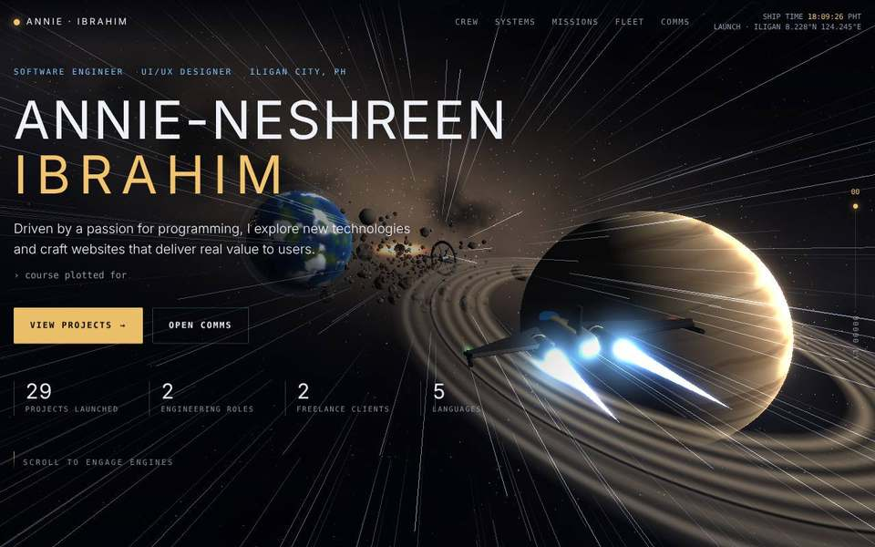
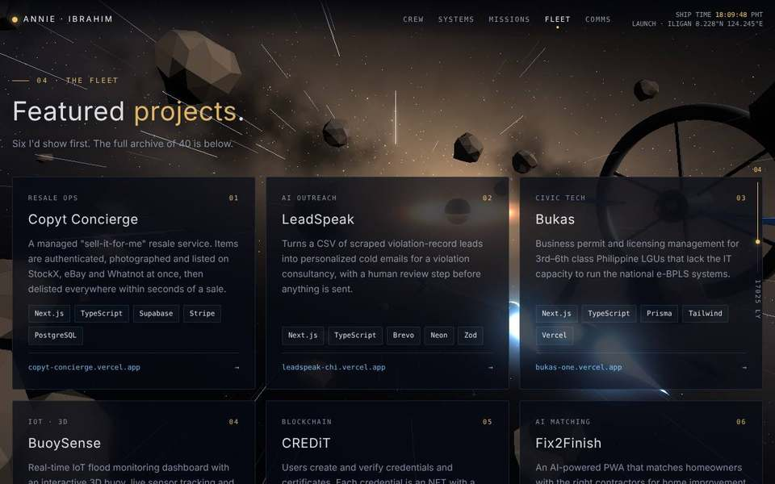

# Annie Ibrahim · Starship Log

> **CCC181 · Application Development and Emerging Technologies**
> Laboratory 1: Personal Portfolio Landing Page
> Annie-Neshreen Ibrahim · BS Information Technology, MSU-IIT

A cinematic **3D space-voyage portfolio** served by a low-level HTTP + WebSocket server written in the **Bonezegei Scripting Language (BSL v1.3.3)**. The page opens with a hyperspace jump. As you scroll, a starship flies across the Milky Way: past a ringed gas giant, an ocean world, an asteroid field and an orbital station, ending at Sagittarius A*, the black hole at the center of the galaxy (about 26,000 light-years from Earth). A live Comms terminal talks to the BSL WebSocket server.



---

## 1. Project Description

This repository is built on the reference template [`msuiit-ph/BSL_HTTP_and_WebSocket`](https://github.com/msuiit-ph/BSL_HTTP_and_WebSocket). The BSL server in `app.bzg` listens on port **8000** and serves `public/index.html` for `/`. The template's plain WebSocket test page has been replaced with my portfolio.

### Portfolio contents

| Section | What it shows |
|---|---|
| **Hero** | Full name, roles, profile summary, quick stats |
| **01 · Crew profile** | About me, crew record (handle, location, certification), core competencies, education |
| **02 · Ship systems** | Skills & technologies grouped into 8 modules (languages, frontend, backend, databases, cloud, design, styling, emerging tech) |
| **03 · Mission log** | Professional experience: Proudcloud Inc., WT Migremo Systems Inc., SparkSoft Solutions, Inc., and freelance work |
| **04 · The fleet** | 6 featured projects with live links, plus an archive of 34 more |
| **05 · Comms** | Email, GitHub, LinkedIn, website, and a **live WebSocket terminal** connected to the BSL server |

### Tech stack

| Layer | Technology |
|---|---|
| Web server | **Bonezegei Scripting Language v1.3.3**, `lib/http.bzg` (HTTP + WebSocket) |
| Markup / style | HTML5, CSS3 (custom properties, `clip-path`, `backdrop-filter`) |
| 3D | **Three.js r160** (ES modules via import map), custom GLSL shaders, `UnrealBloomPass` |
| Animation | **GSAP 3.12.5** + ScrollTrigger |
| Fonts | Michroma, Saira, JetBrains Mono (Google Fonts) |
| Realtime | Browser `WebSocket` API ↔ BSL `server.onData` / `server.sendAll` |

### How the 3D works

- **The Milky Way** is a sky sphere drawn by a custom fragment shader. Fractal noise builds the galactic band, dark dust lanes, faint nebulae and the warm glow of the galactic core. About 6,000 twinkling point stars (2,500 on mobile) are crowded into the band. The sky moves with the camera so it always feels infinitely far away.
- **The starship** is an original design built in code from Three.js primitives: a lathed fuselage, extruded swept wings, a glass canopy, gold trim, blinking navigation lights and two ion engines whose flames and glow pulse with speed.
- **Destinations**, all shaded procedurally (no image files):
  - Hero: a banded gas giant with a ring system.
  - Crew profile: an ocean world with continents, drifting clouds, city lights on its night side, an atmosphere glow and an orbiting moon.
  - Ship systems: an asteroid field of ~420 tumbling rocks (one instanced draw call), with a clear lane left for the ship.
  - Mission log and fleet: a rotating ring station with spokes, lit windows, solar panels and beacons.
  - Comms: Sagittarius A*, a black hole with a swirling accretion disk and photon ring.
- **Scroll-driven flight**: scroll progress (0 → 1) is eased with frame-rate-independent smoothing and mapped onto a `CatmullRomCurve3` route. The ship rides just ahead of a chase camera, banks into turns and follows the mouse. Near the end the camera swings to face the black hole. The HUD rail converts progress into light-years traveled (0 → 26,000 LY).
- **Speed and hyperspace**: 1,600 dust streaks stretch with the camera's velocity. After the boot sequence a hyperspace jump widens the field of view and turns them into long star lines.
- **Performance and accessibility**: pixel ratio is capped, bloom is turned off on mobile, rendering pauses when the tab is hidden, `prefers-reduced-motion` freezes motion, and a CSS starfield replaces the scene if WebGL is unavailable. All content is real HTML text.

---

## 2. Setup & Execution Steps

### Prerequisites

| Platform | Install |
|---|---|
| **Windows** | Open the **Microsoft Store**, search **"Bonezegei Scripting Language"**, and install/update to **v1.3.3**. |
| **Linux / GitHub Codespaces** | `wget https://github.com/bonezegei/Bonezegei_Scripting_Language/raw/refs/heads/main/Release/Latest/Bonezegei-x86.deb`<br>`sudo apt install ./Bonezegei-x86.deb` |
| **Verify** | `bonezegei -v` should print `1.3.3` |
| **VS Code** | Extensions (`Ctrl+Shift+X`), search **"bonezegei"**, install **Bonezegei Scripting Language Formatter** |

An internet connection is needed the first time the page loads, because Three.js, GSAP and the fonts come from pinned CDN versions.

### Steps

1. **Clone the repository**
   ```bash
   git clone https://github.com/hannie404/<your-repo-name>.git
   cd <your-repo-name>
   ```
2. **Open the folder in VS Code**
   ```bash
   code .
   ```
3. **Install dependencies** (pulls the BSL `http` library into `lib/`)
   ```bash
   bzg install
   ```
4. **Run the server**
   ```bash
   bzg run
   ```
   Or click the **Run** button provided by the BSL VS Code extension.
5. **Open the portfolio** at **http://localhost:8000**.
6. **Try the Comms terminal** in the Contact section. Type `help`, `whoami`, `projects` or `ping`. Any other text is broadcast through the BSL WebSocket server to everyone who has the page open (open two tabs to see it).

---

## 3. Execution Verification

### Terminal: `bzg run`


*`bzg run` starts the BSL server on port 8000 without errors. Each page request logs `get loc:/`, and the Comms terminal logs `WebSocket connected! Client ID: …`.*

### Browser: `http://localhost:8000`


*The portfolio rendered in the browser from the BSL server, with the starship, the hero section, and the Comms status showing **Live · localhost:8000**.*

<details>
<summary>More views</summary>



</details>

---

## 4. Project Structure

```
.
├── app.bzg              # BSL HTTP + WebSocket server (port 8000)
├── package.json         # BSL project manifest (dependency: http)
├── lib/                 # created by `bzg install` (BSL http library)
├── public/
│   ├── index.html       # the whole portfolio: HTML + CSS + JS + Three.js scene
│   └── 404.html         # themed "lost in space" page for unknown routes
├── screenshots/         # README images
├── LICENSE              # MIT License
└── README.md
```

### Server routes (`app.bzg`)

| Event | Behaviour |
|---|---|
| `server.get("/")` | Sends `public/index.html` |
| `server.get(other)` | Sends `public/404.html` |
| `server.onConnect` | Sends a "welcome aboard" message to the new terminal client |
| `server.onData` | Replies `pong` to `ping`; broadcasts any other message with `sendAll` |
| `server.onDisconnect` | Logs the disconnect |

---

## 5. Customization

- **Text content** is plain HTML inside `public/index.html`, one `<section>` per part of the page.
- **Projects** live in the `FEATURED` and `ARCHIVE` arrays near the top of the first `<script>`. Add an object or a row and the cards render automatically.
- **Colors and fonts** are CSS tokens at the top of `<style>` (`--gold`, `--ion`, `--ink`, `--f-display`…).
- **The 3D scene** is the `<script type="module">` block. Each object (sky, gas giant, ocean world, asteroids, station, black hole, ship) has its own commented block, and the flight route is one list of points.

---

## 6. Credits

- [Bonezegei Scripting Language](https://github.com/bonezegei/Bonezegei_Scripting_Language) and the [MSU-IIT reference template](https://github.com/msuiit-ph/BSL_HTTP_and_WebSocket)
- [Three.js](https://threejs.org) (MIT), [GSAP](https://gsap.com) (standard "no charge" license)
- Fonts: Michroma, Saira, JetBrains Mono (SIL Open Font License)

## 7. License

Released under the [MIT License](LICENSE) © 2026 Annie-Neshreen Ibrahim.
